# Architecture — AIStandards

> AIStandards is a standards pack: a corpus of numbered, normative AI engineering standards, plus a
> Node CLI with no installed dependency that reads a *target* repository and reports what it can and cannot
> establish about that repository's conformance. It is used by engineers adopting the standards in
> their own repositories, and — from Phase 7 — by StandardsEnforcer, which runs the CLI and reads
> the top-level `status` key of its JSON. Its defining design constraint is negative: no mechanism
> in it may convert absent evidence into a pass.

**Provenance of this document.** Regenerated by the `codebase-docs` skill on 2026-10-11 against the
integration of `feature/st57-structural-reader` with `develop` at 5ecd226 (merge commit b899152), by
reading the module headers, the exported surface and the call sites it names. It replaces the
generation of 2026-09-14, which predated: `init`, the manifest and tool-permission modules and the
templates; the `--strict` audit flag; the lexical-contract freeze (ST-48); and the structural reader
with its vendored YAML parser (ST-57). It describes the implementation at that commit — 18 modules under
`scripts/` plus the vendored tree, 17 of 53 standards written, 46 rules in 8 shards, 35 test files.
Line numbers were taken from that tree. It is **not** a plan and does not describe Phases 4–7.
The superseded pre-implementation capture is preserved separately as
`docs/architecture-baseline-2026-09-03.md`, which must not be overwritten: it is the evidence that
nothing pre-existed the build.

Not re-derived in this generation, and carried from the previous one with its caveats: the detailed
description of the corpus tooling (`fidelity`, `inventory`, `standards-sections`, `sync-rule-tables`),
whose code was not changed by ST-57. Their line numbers were refreshed; their behaviour was not re-read.

`docs/architecture.mmd` and `docs/validate-flow.mmd` are the canonical diagram sources. The fenced
blocks below are byte-identical copies, written by the generation step from those files. No `.svg` is
rendered: that needs a build-time download of a Mermaid renderer, which this repository's
no-installed-dependency rule forbids, and a hand-drawn SVG would be a second definition of the
architecture. Regenerate this document rather than hand-patching it.

---

## Tech Stack

| Layer | Technology |
|---|---|
| Runtime | Node.js ≥ 18 declared (`engines` in `package.json`), ESM `.mjs` throughout. Which versions have executed which tree is recorded per commit in `docs/HANDOFF.md` §3; the ST-57 integration ran the full suite on Node 24.15.0 and 18.20.8 |
| Dependencies | **No install-time or environment-resolved third-party dependency** (invariant 4, as amended). No `dependencies` or `devDependencies` key, no lockfile, no install step, no bare import under `scripts/` — structurally enforced by `test/no-phase-creep.test.mjs`. One third-party parser is **vendored** as reviewed repository content: `yaml@2.9.1` (ISC) under `scripts/vendor/yaml`, identity and per-file SHA-256 pinned in `scripts/vendor/yaml.vendor.json` and held by `test/vendor-yaml.test.mjs`; kept LF by `.gitattributes` |
| Test framework | `node:test` + `node:assert/strict`, run via `scripts/test.mjs` with an explicit list of 35 files (1063 tests at this commit) |
| YAML (policy, manifest) | `scripts/yaml.mjs` — a hand-written subset parser that *refuses* constructs it cannot represent rather than guessing. Kept separate from the structural reader on purpose |
| YAML (structural) | the vendored `yaml` library, used only by `scripts/structural.mjs`, never `toJS`, aliases never dereferenced |
| JSON (structural) | an owned strict RFC 8259 tokenizer in `scripts/structural.mjs` (duplicates and offsets kept; `JSON.parse` is not the semantic parser) |
| JSON Schema | `scripts/jsonschema.mjs` — a hand-written Draft-07 subset validator that throws on a keyword it does not implement |
| Normative corpus | Markdown (`standards/`), JSON rule shards (`rules/`), JSON Schema (`schemas/`), templates (`templates/`) |
| Distribution | `bin` entry `standards` → `scripts/standards.mjs` |

The no-installed-dependency rule is not a preference. A standards pack that installs code from a registry
during its own CI cannot claim to have verified committed content, and a lockfile would make that
failure quiet. The vendored tree is the narrow exception that keeps this true: it is bytes in the
repository, hashed, with its notice, and it is the only code under `scripts/` that is not this pack's own.

## Runtime Processes

There is one product process. AIStandards has no server, no daemon, and no background work.

### `standards` CLI
**Host:** invoked directly by a developer, by `npm run` scripts, by CI, or by StandardsEnforcer as a
subprocess.
**Entry point:** `scripts/standards.mjs` (1227 lines); `main(argv)` at line 1175, dispatched from the
`import.meta.url` guard at the foot of the file. `init` is routed to `runInitCommand` before flag parsing.
**Purpose:** Walks a target repository, reads every in-scope YAML and JSON file once with the
structural reader, runs a fixed sequence of detectors over it, and emits either an evidence report
(`audit`) or a policy-aware verdict (`validate`). It reads the target's own `ai-policy.yml`; it never
falls back to this checkout's policy.

Further executables are gates or corpus tooling rather than products, each with its own `main` and
exit codes: `scripts/fidelity.mjs` (94 lines), `scripts/inventory.mjs` (385),
`scripts/standards-sections.mjs` (533), `scripts/sync-rule-tables.mjs` (450), `scripts/test.mjs` (101)
and `scripts/init.mjs` (352, reached as `standards init`). Only `sync-rule-tables.mjs` (generated
blocks) and `init.mjs` (the explicitly selected target) have a write path.

## Background Jobs

**None.** There are no schedulers, workers, queues, pollers, or cron definitions anywhere in the
repository. Every code path in AIStandards runs synchronously inside one CLI invocation and exits.

## Commands

AIStandards exposes no HTTP surface. Its public interface is the CLI, and this section is the
equivalent of an endpoint inventory. `package.json` wraps each as an npm script: `test`, `audit`,
`validate`, `fidelity`, `inventory`, `catalog-sync`, `catalog-sync:check`, `sections`, `init`.

### `scripts/standards.mjs`
| Command | Flags | Purpose |
|---|---|---|
| `audit <path>` | `--json`, `--strict`, `--dir=` | Evidence discovery. Prints the file surface, the unparseable-file count, the detected AI surface and all findings. Emits **no status and no score**, and prints the literal line `This is evidence, not a verdict.` (`NOT_A_VERDICT`, line 1010). The JSON report is `schemaVersion` `1.1` and carries `evidenceSurface.unparseableFiles` and `structuralSurface`. `--strict` exits 1 when a finding of severity `error` or `warning` exists; without it audit is diagnostic and exits 0 |
| `validate <path>` | `--policy=`, `--json`, `--dir=` | The policy-aware verdict. Loads the target's `ai-policy.yml`, applies applicability, runs the same detectors, and emits an envelope (`schemaVersion` `1.0`) whose top-level `status` is one of five values. The human form lists every result that is not `passed`, then "Prohibitions not established. These are not passes:", then the not-evaluable rules |
| `init <target>` | `--docs`, `--dry-run`, `--force-overwrite=<file>`, `--json` | Copies templates byte for byte into an explicitly selected target. Never defaults to the working directory, refuses the pack root, rolls back on a write failure, and produces scaffolding that satisfies no rule. Exit 0 or 2 only |

**Exit codes** of audit and validate (`scripts/standards.mjs:35-38`) are process semantics only and are
never a verdict: `0` clean · `1` a project-level failure (`NON_COMPLIANT` or `NOT_EVALUATED`, or an
audit `--strict` finding) · `2` a *configuration* error — missing policy, bad flags, version mismatch ·
`3` a structural integrity breach (`BLOCKED_BY_INVARIANT`).

The `2`/`1` split is load-bearing: a broken setup must not be readable as a broken project.

### Gate and corpus scripts
| Command | Exit 0 | Exit 1 | Exit 2 |
|---|---|---|---|
| `node scripts/fidelity.mjs` | every verbatim block matches the brief after the declared CRLF→LF normalization | a block does not match | **zero blocks declared** — a check with nothing to check is a configuration error, not a pass |
| `node scripts/inventory.mjs` | every check that could run passed; checks that could not run are listed as withdrawn, never as passed | a check found a defect | the specification lists no items, or the specification or catalog cannot be read |
| `node scripts/standards-sections.mjs [--root=] [--json]` | every written standard conforms | a finding | bad arguments, missing directories, an unreadable specification, zero documents, or an inconsistent mapping |
| `node scripts/sync-rule-tables.mjs [--root=] [--check]` | in sync, or written | drift found (`--check` only) | malformed input — including a rule cited in no or several requirement sections, and a written standard missing a block for a shard holding its rules — zero blocks, a catalog that does not load, or a bad argument. **Nothing is written when any error exists** |
| `node scripts/test.mjs` | all files passed | a test failed | a listed file is missing, a test file on disk is unlisted, the list is empty, or the runner died |

The zero-work-is-exit-2 rule appears in every one of them, for the same reason each time: an empty run
and a clean run are indistinguishable in stdout, so they must be distinguishable in the exit code.

## Database

**None.** AIStandards has no database, no ORM, no migrations, and no persistent state of any kind.
Every input is a file in the repository or in the target being examined.

## External Integrations

| System | Purpose | How connected |
|---|---|---|
| StandardsEnforcer | Reads AIStandards' verdict for a governed repository | **Not yet connected.** The adapter (`standards-adapter.json`) is Phase 5 and does not exist at this commit. The enforcer would run `validate --json` as a subprocess and parse the top-level `status` key — never the exit code |
| MachineLearningStandards | Owns reproducibility, dataset provenance, evaluation and drift | Referenced by `artifacts/boundary-review.json` and by standards' Scope sections. No code dependency. The planned in-band expression (`boundary.ml-pack-required`) is not implemented |
| Nine adjacent packs, including EngineeringStandards and MathematicsStandards | Rule ids this pack must never reuse | `artifacts/foreign-namespace-inventory.json` records their ids, and `test/namespace.test.mjs` asserts no catalog id collides. Separately, `FOREIGN_NAMESPACES` in `catalog.mjs` refuses the `ai` and `ai-ux` namespaces at load |
| npm registry (`yaml`) | Source of the vendored parser | **Not connected at runtime or install time.** The release was fetched once, verified (tarball integrity, per-file hashes, licence) and committed; `scripts/vendor/yaml.vendor.json` records the tarball URL and hashes. Nothing resolves it again |

There are no network calls anywhere in the codebase. The pack never contacts a model provider, a
registry, or any remote host — including during its own tests.

## Layers & Components

### Entry layer — the CLI
**Responsibility:** argument parsing, the evidence walk, the detector sequence, and the two command bodies.

- `scripts/standards.mjs` — the only executable that examines a target. Holds `SKIP` (line 57 — `.git`
  and `node_modules` as not project evidence, `test/fixtures` at the target root as a *framework*
  exclusion) and the 512 KiB per-file cap `MAX_BYTES` (line 63), `collectFiles()` (65), `readText()`
  (107, returning `{ok, text, truncated}` so a failed read and an empty file are distinguishable),
  `readStructuralFile()` (129) and `readStructuralFiles()` (158), `CONTENT_DERIVED_RULES` (213),
  `EVALUATED_RULES` (222, nine rule ids — five declaring `assurance: full`, four `partial`),
  `createRun()` (234, the single mutable run object with its writers `addFinding`, `observe`,
  `breakInvariant`), the twelve detectors, `checkApplicabilityContradictions()` (963), `runDetectors()`
  (981, a fixed commented sequence, not a registry), `commandAudit()` (1012), `commandValidate()` (1067),
  `parseArgs()` (1161) and `main()` (1175). Exports `EVALUATED_RULES`, `main`, `distinction`,
  `DISPOSITION`.
- **The twelve detectors.** Descriptive, bound to no rule: `detectManifestPresence` (272),
  `detectToolPermissions` (291), `detectPromptAssets` (302), `detectToolDefinitions` (312). Judgmental,
  full assurance: `detectMissingManifest` (338), `detectInvalidManifest` (359), `detectScaffoldManifest`
  (387), `detectMissingToolPermissions` (405), `detectUndeclaredTool` (440). Judgmental, partial
  assurance: `detectFloatingModelAlias` (491, a maintained list `FLOATING_ALIAS` of moving-alias
  shapes), `detectInlineSystemPrompt` (808) and `detectDisabledSafetyControls` (911). Manifest and
  tool-permission detectors classify through `manifest.mjs` and `toolperms.mjs` rather than keeping their own copy,
  and a scaffold file (`manifestIsScaffold`, line 330; `toolPermissionsAreScaffold`, 334) makes every rule
  that would read it report an `unknown` — only `lifecycle.manifest-not-scaffold` reports on the scaffold itself.
- **`detectInlineSystemPrompt`** measures a quoted literal of 200+ characters (`INLINE_THRESHOLD`) in
  three detection shapes, each named in its evidence string: the parameter shape (`INSTRUCTION_PARAM`, a
  listed name then `:` or `=`), the message role shape (`messageRoleLength`, 720: an object or YAML
  mapping whose `role` is `system` and whose own `content` is the literal) and the `systemInstruction`
  parts shape (`systemInstructionPartsLength`, 768). All three search the `codeOnly` view for keys and
  measure the literal in the original text, and are **still lexical**: they are re-expressed over the
  parsed tree by ST-58. Since ST-57, a YAML or JSON file the structural reader could not read is **not
  scanned at all** (`run.structural.failures`); the detector records an `unknown` for both rules
  alongside any violation, so a clean-looking result cannot be a pass. Variables, template and
  concatenated content, typed-part arrays, the `developer` role and keyword-argument constructors are not claimed.
- **`detectDisabledSafetyControls`** searches each code or configuration file's text with comments
  blanked in place (`withoutComments` from `splitSource()`), only when the file names a key in
  `SAFETY_KEY`. It fires on a `DISABLED_SAFETY` literal (`BLOCK_NONE`, `OFF`) or on the off-pattern: a
  key in `OFF_KEYS`, `:` or `=`, then `false` (`OFF_FALSE`) or a quoted `none` / `off`
  (`OFF_QUOTED`, or `OFF_QUOTED_YAML` for `.yml`/`.yaml`, which omits the ternary guard). It stays on the
  lexical layer — including for YAML and JSON the structural reader refused — until ST-49 (#111)
  decides otherwise. Unreadable files are skipped without recording an unknown. A shortened walk
  withdraws a clean result only; the collected files are still scanned and a violation in one still fails.
- The walk does not skip `.claude/` or any other untracked directory. Untracked local files present in
  a checkout are part of what `audit` counts and what content-derived detectors read.

### Structural reader layer — `scripts/structural.mjs` (595 lines)
**Responsibility:** reading YAML and JSON as parsed trees with exact source positions, and returning a
refusal as a value. It is a reader, not a detector; it decides nothing about any rule.

- **Scope.** `isStructuralScope()` — `.yml`, `.yaml`, `.json`, case-insensitive, from the name alone, no
  content sniffing. JSONC, JSON5, JSONL/NDJSON, templates, Markdown fences, notebooks, extensionless
  files and mismatched-extension content are named non-claims. TOML stays lexical.
- **One node shape** for both formats: `map` (`pairs[]` keeping every occurrence, with a `merge` flag),
  `seq`, `scalar` (decoded `value`, `length` in code points, `style`), `alias`. Offsets index the text in
  UTF-16 units; `line` is 1-based on LF; `column` in code points. A UTF-8 BOM is removed and recorded.
- **JSON** is parsed by an owned iterative tokenizer (`parseJsonText`): strict RFC 8259, no comments or
  trailing commas, duplicates preserved, depth not a stack hazard.
- **YAML** is parsed by the vendored library with `uniqueKeys: false`; the adapter converts its nodes,
  recovers where each `&anchor` and `!tag` was written by reading backwards from the node (checked
  against the name the parser reported), never dereferences an alias, records `<<` without applying it,
  reads every document independently and refuses an alias whose anchor was not defined earlier in the
  same document. Every scalar is its decoded **string**; the schema's coerced value is never used.
- **Failure values**, from `FAILURE_REASONS`: `read-failure`, `truncated`, `utf-16`, `invalid-utf-8`,
  `control-character`, `lone-cr`, `syntax`, `empty-document`, `undefined-alias`, `parser-exception`. The
  parser's own message is never carried (it can quote file text); only its code and a position.
- **Interface for consumers:** `parseStructuralBytes()`, `parseStructuralText()`, `walk()` (iterative,
  parents before children, keys before values), `pathOf()`, `codePointLength()`, `isStructuralScope()`,
  `formatOf()`, `decodeStrict()`.
- `scripts/vendor/yaml/` — the library's `browser/**` and `LICENSE`, unmodified; `scripts/vendor/yaml.vendor.json`
  is its identity. The strict policy parser `yaml.mjs` does not import it and `test/vendor-yaml.test.mjs`
  asserts that nothing but `structural.mjs` does.

No file-size cap or timeout is chosen here. The only bound is the existing 512 KiB read bound, which
refuses an oversize file as `truncated` rather than parsing the cut text. The parser is synchronous and
cannot be interrupted; that is a recorded property, not a decision.

### Catalog layer
**Responsibility:** loading the rule shards and refusing a catalog that violates its own invariants.

- `scripts/catalog.mjs` (241 lines) — `loadCatalog()` (line 163) reads `rules/*.json` and throws
  `CatalogError` on any breach found by `checkRule()` (line 79). Owns `RULE_ID` (line 30),
  `VALIDATION_TYPES`, `ASSURANCE` (`full`, `partial`, `none`), `LEVELS`, `SEVERITIES`, the 17-entry
  `NAMESPACES` set (line 43), `FOREIGN_NAMESPACES` (line 50), `SHARED_SEGMENTS` (line 60, six segments
  declared as also used by another pack, `agent` among them), `resolve()` (199), `assertBindings()`
  (line 210) and `coverage()` (line 225). A `not-evaluable` rule must declare assurance `none`, may not
  be attestable or `nonExemptible`, and must carry a substantive `$notEvaluableNote`. A rule's
  `assurance` is a catalog declaration; nothing measures it.

### Policy layer
**Responsibility:** finding, loading and applying the *target's* policy — the pack's single most
security-relevant seam.

- `scripts/policy.mjs` (146 lines) — `resolvePolicyPath()` (line 40) joins `POLICY_BASENAME`
  (`ai-policy.yml`) onto the target directory. **The pack root is never passed in as a fallback
  argument, so there is no code path in which it could be used.** `loadPolicy()` (line 54) validates
  against `schemas/ai-policy.schema.json`; `assertVersionIdentity()` (line 98) refuses a policy pinned
  to a different framework version; `applyPolicy()` (line 116) applies applicability declarations.
  Every failure is `PolicyError` → exit 2.

### Judgment layer
**Responsibility:** turning observations into a verdict, and deriving the six-way distinction.

- `scripts/compliance.mjs` (317 lines) — holds **four separate vocabularies** that are never
  merged: `STATUS` (5 values), `RESULT` (4), `DISPOSITION` (5), `DISTINCTION` (6). `distinction()`
  (line 58) is a **pure derived function** of `(result, disposition, level)` — never stored, so it
  cannot drift from the vocabularies it summarises. Its branch order is load-bearing: the
  `forbidden` branch is tested *before* the general not-evaluated branch, so an unestablished
  prohibition reports as `prohibited-but-unestablished` and never merely as `not-evaluated`.
- `evaluateRule()` (line 91) turns one rule's observations into a result, in this order:
  not-applicable → `skipped / not-applicable`; `not-evaluable` → `skipped / not-evaluated`; outside
  `EVALUATED_RULES` → `skipped / not-evaluated`; any confirmed violation → `failed` (or `warning` for a
  `recommended` level or `warning` severity), carrying only the confirmed evidence and kept over any
  unknown; any unknown → `skipped / not-evaluated` with the unknown's own message; **a clean result from
  a rule declaring `assurance: partial` → `skipped / not-evaluated`**, with a message saying the check ran
  over a declared partial scope; otherwise `passed`. The partial branch is Standard 5 R6's "covered less
  than the rule requires".
- `evaluate()` (line 207) decides the status: invariant violations → `BLOCKED_BY_INVARIANT` with
  `score: null`; required or forbidden failures → `NON_COMPLIANT`; any applicable, not-evaluable-excluded
  rule with disposition `not-evaluated` → `NOT_EVALUATED`; else `COMPLIANT`. The score is passed ÷
  scored, where scored is applicable minus not-evaluable. `envelope()` (line 296) builds the emitted report.

### Parser and lexical layer — no installed dependency
**Responsibility:** reading policy and manifest YAML strictly, validating JSON Schema, and splitting
source into use and mention.

- `scripts/yaml.mjs` (248 lines) — `parseYaml()` (line 123). The `REFUSED` list (line 26) names the
  constructs it will not guess at (block scalars among them); it throws `YamlError` rather than
  returning a plausible wrong value. Used for the policy, the manifest and the tool-permission file.
- `scripts/jsonschema.mjs` (254 lines) — `validate()` (line 78) and `assertValid()` (line 249). An
  unimplemented keyword **throws**; it is never skipped.
- `scripts/source.mjs` (278 lines) — `splitSource()` (line 117) performs the **USE/MENTION split**,
  selecting comment syntax by extension from `SYNTAX` (line 14) and `BY_EXTENSION` (line 22). It returns
  the `code`, `comments`, `strings`, `withoutComments` and `codeOnly` views, index-aligned with the
  original text. `isCode()` (34) and `extensionOf()` (39) are exported beside it. The YAML branches
  (`BLOCK_HEADER`, `yamlBlockScalarEnd` at 55, and the three `isYaml` uses) are shared with Standard 9
  and are **frozen** by `test/source-yaml-freeze.test.mjs`; the source-code forms are frozen by
  `docs/lexical-contract.md` and `test/lexical-contract.test.mjs` (ST-48).
- `scripts/manifest.mjs` (53 lines) and `scripts/toolperms.mjs` (51 lines) — pure functions over text:
  `classifyManifest()` / `classifyToolPermissions()` return `unparseable`, `invalid`, `scaffold` or `ok`
  in that order, so a schema problem outranks the scaffold marker. They import `yaml`, `jsonschema` and `scaffolding`.
- `scripts/scaffolding.mjs` (98 lines) — `SCAFFOLD_MARKER` (`$scaffold`), `SCAFFOLD_TEXT_MARKER`,
  `isPlaceholder()` and `inspectScaffolding()`. Exists from Phase 1, not retrofitted, so generated
  placeholder content can never satisfy a rule.

### Initialisation layer
**Responsibility:** the one command that writes into a target.

- `scripts/init.mjs` (352 lines) — `runInitCommand()` (316). `loadRegistry()` (82) reads
  `templates/index.json`; `buildPlan()` (182) inspects every destination and reports conflicts before
  writing; `apply()` (247) writes and `rollbackAndReport()` (238) undoes a partial write. `templates/`
  holds 13 files (including `index.json`) copied byte for byte (manifest, tool-permission file, policy, agent-instruction
  files and report templates). No network, no rendering.

### Specification layer
**Responsibility:** parsing the derived specification and the brief, so the review gates can compare
them.

- `scripts/spec.mjs` (206 lines) — `readSpec()`, `readPrompt()`, `readBoundaryReview()` (line 56),
  `verbatimBlocks()` (line 72), `parseSpec()` (line 130), `additionsSection()` (line 199). Owns
  `CLASSES` (`D` derived / `V` verbatim / `A` authored), `POSTURES` (`O`/`B`/`X`/`D`),
  `ADDITIONS_HEADING`, and `normalizeEol` — the **single declared normalization** (CRLF→LF on both
  sides) used for verbatim comparison, with raw-byte matches reported separately.

### Gate and corpus-tooling layer
**Responsibility:** the checks that keep the catalog, the specification and the standard documents in
agreement, and the one tool that writes the documents' generated tables. (Behaviour as described in the
2026-09-14 generation; these modules were not changed by ST-57.)

- `scripts/fidelity.mjs` — compares every class-V block against the brief. Its header states plainly
  what it *cannot* establish: that the quoted block is the right block, that an unquoted passage is
  honoured, or that any standard written under a block says what the block requires.
- `scripts/inventory.mjs` — seven check functions: `checkNumbering` (42), `checkDerivation` (59),
  `checkAuthoredDeclarations` (96), `checkProhibitionsNameTheirPositive` (126),
  `checkImplementations` (152), `checkBoundary` (223), `checkRuleBindings` (290), called from `main()`
  (314). A document check for an unwritten item is reported as withdrawn and is explicitly **not** a pass.
- `scripts/standards-sections.mjs` — document conformance for every written standard. The mapping from
  the brief's nine requirements to Standard 6's ten H2 sections is held as data (`BRIEF_REQUIREMENTS`,
  `REQUIRED_SECTIONS`, `BRIEF_TO_SECTION`, `INHERITED_SECTIONS`) and checked by `mappingProblems()`
  (line 98) before any document is read. `scan()` (158) reads headings outside fences and comments;
  `checkDocument()` (210) rejects a missing, duplicated, out-of-order or empty section. No write path.
- `scripts/sync-rule-tables.mjs` — the catalog is the source of truth for each rule's level, severity,
  validation type and exemptibility; this tool rewrites the body of every generated block from it.
  `findBlocks()` (86), `documentNumber()` (133), `requirementSections()` (155), `renderBlock()` (190),
  `requiredCoverage()` (300), `coverageProblems()` (316), `planSync()` (336) and `main()` (392). It
  collects every error across every document before anything is written, preserves each file's line
  ending, and refuses a file mixing CRLF and LF.
- `scripts/test.mjs` — the explicit `FILES` list (line 21) run with `--test --test-concurrency=1`; a
  listed file missing from disk, or a test file on disk missing from the list, is exit 2.

## Data Flow

An end-to-end `validate` run, naming the real functions:

1. `main(argv)` (`scripts/standards.mjs:1175`) parses flags via `parseArgs()` and dispatches to
   `commandValidate(target, flags)` (line 1067).
2. `loadCatalog()` (`catalog.mjs:163`) reads all eight `rules/*.json` shards, checks every catalog
   invariant, and throws `CatalogError` on breach.
3. `resolvePolicyPath(target, flags.policy)` (`policy.mjs:40`) produces
   `{path, source: "explicit" | "target-default"}` — resolved **against the target**.
4. `loadPolicy()` parses the YAML through `parseYaml()` and validates it against
   `schemas/ai-policy.schema.json`. `assertVersionIdentity()` then refuses a version mismatch. **Any
   failure here returns exit 2 and emits no envelope at all.**
5. `applyPolicy(catalog, policy)` (`policy.mjs:116`) produces the resolved rule set with the
   project's applicability declarations applied.
6. `createRun(target)` (line 234) calls `collectFiles()`, which walks the tree honouring `SKIP` and records
   the evidence surface — including which directories the *framework* excluded, the only exclusion
   class that invalidates completeness.
7. `runDetectors(run)` (line 981) runs the four descriptive detectors first (they emit findings with
   `rule: null`, because binding an observation to a rule would manufacture a verdict), then
   `readStructuralFiles(run)`, which parses every `.yml`/`.yaml`/`.json` file once and records, per
   file, a parsed tree summary or a failure. Then the five full-assurance judgmental detectors and the
   three partial-assurance ones. If the walk was shortened, `withdrawn` is true and the
   content-derived detectors withdraw a clean result rather than report it clean; a violation in a
   collected file still fails. A file the reader refused is skipped by `detectInlineSystemPrompt` and
   becomes an `unknown` for both inline-prompt rules.
8. `assertBindings(catalog, observedIds)` fails the run if a detector observed a rule the catalog
   does not contain.
9. `checkApplicabilityContradictions(run, resolved)` (line 963) raises
   `invariant.applicability-contradicted` when the policy declares a rule not-applicable while a
   detector observed a violation of it.
10. `evaluate({resolved, observations, evaluatedRules: EVALUATED_RULES, invariantViolations})`
    (`compliance.mjs:207`) evaluates each rule through `evaluateRule()` — where a clean partial-assurance
    result becomes `not-evaluated` and a violation is kept over an unknown — and decides the status.
    Invariant violations win first and force `score: null`.
11. `envelope()` (`compliance.mjs:296`) builds the report, carrying `distinction` per result and
    `unestablishedProhibitions`, `notEvaluable` and `frameworkCoverage` — all of which sit *outside*
    `status` and `denominator`.
12. `commandValidate` prints JSON or a human summary and maps the status to an exit code.

`audit` follows steps 6–8 only, then emits `evidenceSurface` (with `unparseableFiles`),
`structuralSurface`, `aiSurface` and `findings`; it has no policy and no verdict.

**Failure path:** steps 3–4 are the FinancialStandards trap this design exists to avoid — a pack
resolving policy against its own checkout, labelling the report with its own name, and exiting 0. A
missing policy is exit 2 with no envelope, and `test/policy-resolution.test.mjs` asserts the emitted
`project` is the fixture's name and not `AIStandards`.

**The structural failure path, observed.** A target holding `system: "<250 characters>"` followed by
`bad: [unclosed` in a `.yml` file used to report the inline-prompt rules as failed from a lexical match.
The reader refuses the file (`syntax`, with line and column), the detector never scans its text, the
audit lists it under `evidenceSurface.unparseableFiles`, and both rules report `skipped / not-evaluated`
with the unknown's message. The same text in a file that parses still fails. Pinned by
`test/structural-audit.test.mjs` and the regression ledger in `test/structural-ledger.test.mjs`.

**The partial-assurance path, observed.** `test/fixtures/q13-synthetic-env-block-none/` sets
`SAFETY_SETTINGS=BLOCK_NONE` in a `.env` file, a type `detectDisabledSafetyControls` does not read, and
its synthetic policy declares every rule outside `EVALUATED_RULES` not-applicable. The detector records
a clean observation; `evaluateRule()` reports `misuse.safety-controls-not-disabled` as
`prohibited-but-unestablished`, the project as `NOT_EVALUATED`, and exit 1.

**Corpus flow.** A standard's rule table is not typed by hand. A rule is added to its shard; the
document cites the rule id in exactly one `### RN` section and carries a marker pair for the shard;
`node scripts/sync-rule-tables.mjs` fills the block; `--check`, `standards-sections.mjs` and
`inventory.mjs` then confirm the table, the structure and the specification row agree.

## Key Patterns & Conventions

- **Four vocabularies, never merged.** `STATUS`, `RESULT`, `DISPOSITION`, `DISTINCTION` in
  `compliance.mjs:14-45`. Collapsing any two would destroy a distinction the brief requires.
- **Derived, never stored.** `distinction()` (`compliance.mjs:58`) is a pure function.
- **A run that checked nothing is not a run that passed.** Zero-work is exit 2 in every gate script.
- **A narrow check never passes.** A rule declaring `assurance: partial` reports a clean result as
  `not-evaluated` (`evaluateRule()`, `compliance.mjs:91`); only `full` assurance reaches `passed`.
- **Unknown is never pass, and a refusal is a value.** The structural reader returns a failure with a
  reason from a closed list; its consumer turns that into an `unknown` and a report entry, never into a
  clean result and never into a lexical guess (`structural.mjs`, `detectInlineSystemPrompt`).
- **Withdraw, never report clean — where the detector knows.** When the evidence walk is shortened,
  content-derived rules are withdrawn to not-evaluated when nothing was found (`CONTENT_DERIVED_RULES`,
  line 213); a finding in a collected file is never withdrawn.
- **Descriptive before judgmental, `rule: null` on the descriptive ones.** `runDetectors()` line 981.
- **Foreign namespaces are refused, not merely avoided.** `FOREIGN_NAMESPACES` in `catalog.mjs:50`.
- **Parsers refuse rather than guess.** `yaml.mjs`'s `REFUSED` list (line 26); `jsonschema.mjs` throws on
  an unimplemented keyword; the structural reader refuses lone CR, control characters and invalid UTF-8.
- **Vendored means pinned, not trusted.** The vendored tree is hashed file by file, carries its notice,
  is LF by attribute, and is imported by exactly one module (`test/vendor-yaml.test.mjs`).
- **Use/mention split, positions kept.** `source.mjs:117`. Discussion of a hazard is never a finding, and
  blanking comments in place keeps a key next to its value.
- **Additive schema changes ship with their producer.** `schemas/audit-report.schema.json` is closed
  (`additionalProperties: false`); `unparseableFiles` and `structuralSurface` were added in the change
  that emits them, and `test/structural-audit.test.mjs` validates the real output against it.
- **The catalog writes the tables; a tool that writes refuses before writing anything.**
  `sync-rule-tables.mjs` collects every error first, and never inserts a block it was not given.
- **Gates have no write path.** `fidelity.mjs`, `inventory.mjs` and `standards-sections.mjs` only read.
- **Explicit test file list, no globs.** `scripts/test.mjs:21` — a glob matching nothing looks
  exactly like a suite that passed.
- **`--test-concurrency=1` is mandatory.** The fidelity, inventory and sync-rule-tables mutation suites
  corrupt and restore real files; two runs in one checkout at once — even two separate processes — can
  corrupt it.
- **Synthetic fixtures say so.** The `q13-synthetic-*` policies label themselves, and every
  not-applicable reason in them, as test inputs rather than applicability approvals, and a test asserts
  the labels.

## Entry Points for Common Tasks

| Task | Where to start |
|---|---|
| Add a standard | `standards/NN-kebab-case.md`, ten H2s in the order fixed by `standards/06-standard-structure-and-rule-identity.md`; claim it in the `Implemented by` column of the item's row in `artifacts/prompts/ai-standards-spec.md`; add the filename to the list in `test/no-phase-creep.test.mjs`. If rules cite its number, put a marker pair per shard in its Validation section and run `node scripts/sync-rule-tables.mjs`; then `node scripts/standards-sections.mjs` |
| Add a rule | The matching `rules/*.json` shard. The ID must match `RULE_ID` in `catalog.mjs:30` and its namespace must be in `NAMESPACES` (line 43). If its standard is written, cite it in one `### RN` section and regenerate the table |
| Add a rule namespace | `NAMESPACES` in `scripts/catalog.mjs:43`, and `SHARED_SEGMENTS` if another pack uses the segment |
| Add a detector | `scripts/standards.mjs` — write the function, insert it into `runDetectors()` (line 981) in the correct band, and add its rule ID to `EVALUATED_RULES` (line 222). Declare the rule's `assurance` honestly: `partial` means a clean result is reported not-evaluated. A test asserts detectors and the list agree in both directions |
| Detect over YAML or JSON structure | Consume the tree from `scripts/structural.mjs` (`parseStructuralBytes`, `walk`, `pathOf`) rather than adding a regular expression; the lexical YAML branches are frozen (`test/source-yaml-freeze.test.mjs`). Re-expressing the inline-prompt shapes is ST-58 (#120) |
| Change the audit report | `schemas/audit-report.schema.json` and `commandAudit()` in the same change; raise `schemaVersion` for an additive field; `test/structural-audit.test.mjs` validates real output against the schema |
| Change how a result is judged | `evaluateRule()` in `scripts/compliance.mjs:91`, against Standard 5 R6; the unit tests are in `test/compliance.test.mjs`, the CLI reproductions in `test/partial-assurance.test.mjs` |
| Add a schema | `schemas/*.json`, registered in the `SCHEMAS` map at `scripts/standards.mjs:43` |
| Add a test | Write `test/<name>.test.mjs` **and** add it to the explicit `FILES` list in `scripts/test.mjs:21` — the runner exits 2 otherwise |
| Add a fixture | `test/fixtures/<name>/`. Judgmental detectors need a provoking **and** a non-provoking pair; a partial-assurance control asserts no violation and the not-established distinction. A YAML or JSON fixture must now be valid YAML or JSON, or it tests the refusal and not the detector |
| Add a template | `templates/` and its entry in `templates/index.json`; `init` copies it byte for byte |
| Update the vendored parser | A new decision, not an edit: replace the tree, regenerate `scripts/vendor/yaml.vendor.json`, and re-run the vendoring gate (integrity, licence, hostile input, Node 18 and 24) |
| Change the brief's quoted text | You cannot. `artifacts/prompts/original_prompt.md` is never edited; `fidelity.mjs` compares against it |

## Module Graph

| Module | Lines | Responsibility | Imports (internal) |
|---|---|---|---|
| `scripts/standards.mjs` | 1227 | CLI, file walk, detectors, both commands | catalog, policy, compliance, source, structural, scaffolding, manifest, toolperms, init, jsonschema |
| `scripts/structural.mjs` | 595 | Structural reader: YAML and JSON trees, positions, failures | vendor/yaml |
| `scripts/standards-sections.mjs` | 533 | Ten-section document conformance | spec |
| `scripts/sync-rule-tables.mjs` | 450 | Generated rule tables and their coverage | catalog |
| `scripts/inventory.mjs` | 385 | Catalog review checks | spec, catalog |
| `scripts/init.mjs` | 352 | Template initialisation of a selected target | — |
| `scripts/compliance.mjs` | 317 | Vocabularies, `distinction`, `evaluate`, `envelope` | — |
| `scripts/source.mjs` | 278 | Lexical use/mention split (YAML branches frozen) | — |
| `scripts/jsonschema.mjs` | 254 | Draft-07 subset validator | — |
| `scripts/yaml.mjs` | 248 | Strict YAML subset parser for policy and manifests | — |
| `scripts/catalog.mjs` | 241 | Rule loading and catalog invariants | — |
| `scripts/spec.mjs` | 206 | Specification and brief parsing | — |
| `scripts/policy.mjs` | 146 | Target-relative policy resolution | yaml, jsonschema |
| `scripts/test.mjs` | 101 | Explicit-list test runner | — |
| `scripts/scaffolding.mjs` | 98 | Placeholder detection | — |
| `scripts/fidelity.mjs` | 94 | Verbatim comparison gate | spec |
| `scripts/manifest.mjs` | 53 | Manifest classification from text | yaml, jsonschema, scaffolding |
| `scripts/toolperms.mjs` | 51 | Tool-permission classification from text | yaml, jsonschema, scaffolding |
| `scripts/vendor/yaml/**` | 76 files | Vendored `yaml@2.9.1`, unmodified | itself only |

`compliance.mjs`, `catalog.mjs`, `yaml.mjs`, `jsonschema.mjs`, `source.mjs`, `scaffolding.mjs`, `spec.mjs`
and `init.mjs` have no internal imports at all, which is why they are unit-testable without spawning the
CLI. `structural.mjs` imports only the vendored tree.

## Diagram — structure

```mermaid
flowchart TB
    subgraph govern["Governing inputs (never generated)"]
        brief["artifacts/prompts/<br/>original_prompt.md"]
        spec["artifacts/prompts/<br/>ai-standards-spec.md"]
        boundary["artifacts/<br/>boundary-review.json"]
        foreign["artifacts/foreign-<br/>namespace-inventory.json"]
    end

    subgraph gates["Review gates and corpus tooling (exit 0/1/2)"]
        fidelity["fidelity.mjs<br/>verbatim bytes"]
        inventory["inventory.mjs<br/>catalog review checks"]
        specmod["spec.mjs<br/>spec + prompt parser"]
        sections["standards-sections.mjs<br/>ten-section conformance"]
        sync["sync-rule-tables.mjs<br/>tables + coverage"]
        nstest["test/namespace.test.mjs<br/>no full-id collision"]
    end

    subgraph corpus["Normative corpus"]
        stds["standards/*.md<br/>17 of 53 written"]
        rules["rules/*.json<br/>8 shards, 46 rules"]
        schemas["schemas/*.json<br/>5 schemas"]
    end

    subgraph engine["Evaluation engine"]
        cli["standards.mjs<br/>audit · validate"]
        catalog["catalog.mjs<br/>load + invariants"]
        policy["policy.mjs<br/>target-relative resolve"]
        compliance["compliance.mjs<br/>evaluate · envelope · distinction<br/>partial clean = not-evaluated"]
    end

    subgraph parsers["Parsers (no installed dependency)"]
        yaml["yaml.mjs<br/>strict policy and manifest subset"]
        jsonschema["jsonschema.mjs"]
        source["source.mjs<br/>lexical use/mention split,<br/>comments blanked in place"]
        scaffolding["scaffolding.mjs"]
        manifest["manifest.mjs, toolperms.mjs<br/>classify from text"]
    end

    subgraph structural["Structural reader (ST-57)"]
        reader["structural.mjs<br/>YAML + JSON trees, offsets,<br/>failures as values"]
        vendored["scripts/vendor/yaml<br/>yaml 2.9.1, pinned, unmodified"]
    end

    subgraph out["Outputs"]
        auditrep["audit report<br/>evidence, no verdict"]
        valrep["validate report<br/>status + distinction[]"]
    end

    target[("Target repository<br/>+ ai-policy.yml")]

    brief -->|"byte compare"| fidelity
    spec --> specmod
    specmod --> inventory
    specmod --> sections
    boundary --> inventory
    spec -->|"claims an<br/>implementing file"| stds
    stds --> inventory
    stds -->|"headings, H1,<br/>Source line"| sections
    rules --> inventory
    foreign -->|"recorded foreign ids"| nstest
    catalog --> nstest

    rules --> catalog
    catalog --> sync
    sync -->|"rewrites generated<br/>blocks only"| stds
    schemas --> policy
    schemas --> cli
    catalog --> cli
    target -->|"file walk,<br/>512 KB cap"| cli
    target -->|"ai-policy.yml"| policy
    policy --> cli
    yaml --> policy
    yaml --> cli
    manifest --> cli
    vendored -->|"relative import"| reader
    reader -->|"every .yml/.yaml/.json once;<br/>unparseable = unknown"| cli
    jsonschema --> policy
    source --> cli
    scaffolding --> cli
    cli -->|"observations +<br/>rule assurance"| compliance
    cli -->|"audit"| auditrep
    compliance -->|"validate"| valrep

    classDef input fill:#f4f0e6,stroke:#8a7d5a,color:#2b2b2b
    classDef gate fill:#e6eef4,stroke:#4a6f8a,color:#2b2b2b
    classDef code fill:#eaf0e6,stroke:#5a7d4a,color:#2b2b2b
    classDef output fill:#f4e6ea,stroke:#8a4a5f,color:#2b2b2b

    class brief,spec,boundary,foreign input
    class fidelity,inventory,specmod,sections,sync,nstest gate
    class cli,catalog,policy,compliance,yaml,jsonschema,source,scaffolding,manifest,reader,vendored,stds,rules,schemas code
    class auditrep,valrep output
```



## Diagram — the `validate` flow

```mermaid
sequenceDiagram
    autonumber
    actor Caller as Caller (CI, StandardsEnforcer, developer)
    participant CLI as standards.mjs
    participant Pol as policy.mjs
    participant Cat as catalog.mjs
    participant Det as detectors (in standards.mjs)
    participant Rdr as structural.mjs
    participant Comp as compliance.mjs

    Caller->>CLI: validate <target> --json
    CLI->>Cat: loadCatalog(rules/)
    Cat-->>CLI: 46 rules in 8 shards, or throw CatalogError
    CLI->>Pol: resolvePolicyPath(target, --policy)
    Note over Pol: Resolved against the TARGET.<br/>The pack root is never a fallback.
    Pol-->>CLI: {path, source: explicit | target-default}
    CLI->>Pol: loadPolicy + assertVersionIdentity

    alt policy missing, malformed, or version-mismatched
        Pol--xCLI: PolicyError
        CLI-->>Caller: exit 2, NO envelope
        Note over Caller: A configuration failure is not<br/>a compliance failure. Never a pass.
    end

    Pol-->>CLI: resolved rule set (applicability applied)
    CLI->>Det: createRun(target) then runDetectors
    Note over Det: Descriptive detectors first (rule: null),<br/>judgmental after. A shortened walk<br/>withdraws content-derived rules.
    Det->>Rdr: readStructuralFiles: parse every .yml/.yaml/.json once
    Rdr-->>Det: parsed (counts, aliases not followed)<br/>or a failure value per file
    Note over Det: A file that failed is never scanned lexically.<br/>The inline-prompt rules get an unknown for it.
    Det-->>CLI: observations[], findings[], invariantViolations[]
    CLI->>CLI: assertBindings(catalog, observed rule ids)
    CLI->>CLI: checkApplicabilityContradictions(run, resolved)

    alt an invariant broke
        CLI->>Comp: evaluate(... invariantViolations)
        Comp-->>CLI: BLOCKED_BY_INVARIANT, score null
        CLI-->>Caller: exit 3
    else normal path
        CLI->>Comp: evaluate + envelope
        Note over Comp: Per rule: violation fails; unknown is<br/>not-evaluated; a clean result from an<br/>assurance-partial rule is not-evaluated,<br/>never passed; only a clean full check passes.
        Note over Comp: distinction() derived per result.<br/>forbidden branch tested BEFORE<br/>the general not-evaluated branch.
        Comp-->>CLI: envelope with top-level status
        CLI-->>Caller: JSON + exit 0 / 1
    end
```

## Gaps — where the code is genuinely unclear or absent

These are recorded rather than guessed at, per the brief's requirement to preserve uncertainty.

| Gap | State |
|---|---|
| `standards-adapter.json` | Does not exist. Phase 5. Until it does, nothing observable connects this pack to StandardsEnforcer |
| Detector coverage | 9 of 46 rules are in `EVALUATED_RULES`; 5 are `not-evaluable`. The rest report `skipped / not-evaluated` by construction. This is the honest floor, not an omission |
| Coverage is declared, not measured | A clean result is `passed` only for a rule declaring `assurance: full`. Nothing checks that such a rule's detector really covers it, so a `full` detector's own blind spots would still report `passed`. Phase 3 |
| Structural reader not yet consumed | Since ST-57 an unparseable YAML or JSON file is unknown for the inline-prompt rules, but the shapes themselves are still matched lexically in files that parse (ST-58), the remaining YAML-specific lexical branches are not retired (ST-59), and Standard 21's text and assurance notes do not yet describe the structural contract (ST-60) |
| Locations on violation evidence | The structural reader exposes node positions, but a violation's evidence strings are unchanged and carry no structured location; that needs the shapes expressed over the tree |
| Duplicate anchors | Valid YAML, parsed, and a lexical finding stands (owner decision of 2026-10-11 for ledger case g07). The named regression ledger expected it to become unknown |
| JSONC and templates named `.json` / `.yaml` | Not supported, by decision. A `.json` file that is really JSONC is unparseable, hence unknown for the inline rules, in any repository containing one; a prospective non-claim, not a defect. No tracked file in this repository is JSONC |
| Resource limits | No file-size cap or timeout was chosen for the structural reader. The parser is synchronous and cannot be interrupted; the only bound is the 512 KiB read bound. A separate evidenced decision is required |
| `COMPLIANT` and partial rules | While any of the four partial-assurance rules applies, `COMPLIANT` is unreachable: a clean result holds the status at `NOT_EVALUATED`, and a confirmed violation makes it `NON_COMPLIANT` or a warning. A project reaches `COMPLIANT` only where every partial-assurance rule is declared not-applicable. This follows Standard 5 R6 and is intended |
| Partial detectors' limits | `detectDisabledSafetyControls` does not read `.env`, `.ini`, `.tf` or Markdown, does not see unquoted YAML `off` or a value reached through a variable, and over-matches in some shapes. Standard 9's Implementation section records them. They no longer produce a pass, but they can produce a false failure. Moving Standard 9 or TOML to the structural layer is ST-49 (#111) alone |
| Field meaning | `assurance.automated` counts only results with disposition `evaluated`; a clean partial result counts under `assurance.notEvaluated`. `schemas/validate-report.schema.json` does not describe either field's meaning |
| Standard 5 R2 wording | Its meanings table describes `not-evaluated` as nobody looking or a check not running, and does not name a partial check that ran clean. Open as Q14 |
| Coverage checked once | Only `sync-rule-tables.mjs` and its tests check that every written standard carries a block for each shard with its rules; `test/standards-tables.test.mjs` does not |
| `boundary.ml-pack-required` | Planned in-band expression of the MachineLearningStandards dependency. Not implemented, and unilateral until ML's maintainers accept it |
| Attestations, containers, workflows, adapter | Phases 4–6. No code exists |
| `artifacts/boundary-review.json` | `humanSignOff` is `null`. Every posture is a unilateral judgment; no adjacent pack's maintainers have confirmed any of it |
| Untracked local files | The walk has no exclusion for `.claude/` or other untracked directories, so `audit`'s file count depends on what a checkout holds beyond its tracked files |
| The vendored tree is audited | `collectFiles` reads `scripts/vendor/**`, so the pack's own audit counts its 76 files and scans the `.js` lexically; no finding results at this commit |
| Node floor | `engines` declares `>=18`; only the versions `docs/HANDOFF.md` §3 records and the ST-57 integration (18.20.8, 24.15.0) have been executed |
| `core.autocrlf` | `true` on the development host. `.gitattributes` exists only to pin `scripts/vendor/**` to LF (it does not answer Q8, the repository-wide policy, which stays open); other files remain CRLF in a Windows working tree and LF in the index. Harmless for `fidelity.mjs`, which normalizes both sides |
